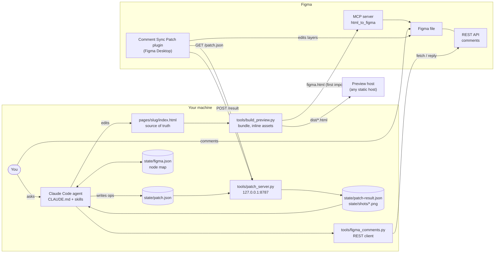
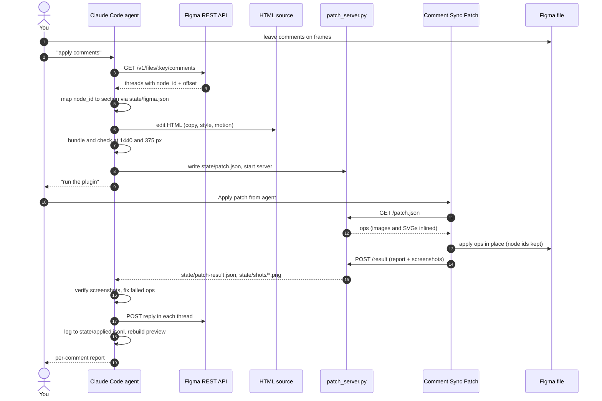
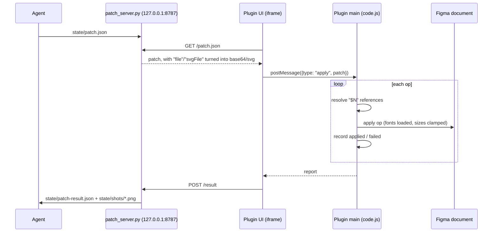

# figma-comment-sync

**English** · [Русский](README.ru.md)

A Claude Code agent that keeps an HTML page and a Figma file in sync around design review.
You leave comments in Figma. The agent reads them, changes the HTML, applies the same change to
the Figma file through a small plugin, replies in each comment thread, and republishes an
animated HTML preview.

- **HTML is the source of truth.** It carries the real layout, copy and motion.
- **Figma is the review surface.** Designers and stakeholders comment on frames there.
- **The preview is what people scroll.** One self-contained HTML file with motion intact.

## Contents

- [How it works](#how-it-works)
- [Architecture](#architecture)
- [The comment loop, step by step](#the-comment-loop-step-by-step)
- [The plugin bridge](#the-plugin-bridge)
- [Requirements](#requirements)
- [Setup](#setup)
- [Daily use](#daily-use)
- [Repository layout](#repository-layout)
- [Design decisions and limits](#design-decisions-and-limits)
- [Security](#security)
- [Troubleshooting](#troubleshooting)

## How it works

The agent is Claude Code plus the instructions in this repository: `CLAUDE.md` (role, routing,
rules) and three skills in `.claude/skills/` (`page-build`, `figma-comments-loop`, `localize`).
Claude Code loads them automatically when you start it in the repository folder. The rest is
plain Python and a Figma plugin, with no dependencies beyond the Python standard library.

It talks to Figma over three channels, each chosen for one job:

| Channel | Job | Why this channel |
|---|---|---|
| **Figma REST API** with a personal token (`tools/figma_comments.py`) | Read comments, reply in threads | Neither the Plugin API nor the Figma MCP server can read comments |
| **Figma MCP server** (`html_to_figma`, `create_new_file`) | Create the file; import whole sections from HTML the first time | The only way to turn HTML into editable Figma layers in one step |
| **Comment Sync Patch plugin** + local bridge (`plugin/`, `tools/patch_server.py`) | Every edit after the first import; reads (`inspect`, `screenshot`) | Free of MCP call limits, deterministic, reports back |

On Figma's free plan the MCP server allows only about 20 calls a month, and edits through
`use_figma` counted against that budget in practice. The plugin exists so that the everyday loop
spends no MCP calls at all.

## Architecture



### Components

| Component | File | Role |
|---|---|---|
| Agent instructions | `CLAUDE.md` | Role, command routing, which channel to use, hard rules |
| Page workflow | `.claude/skills/page-build/SKILL.md` | Brief → HTML → local check → first Figma import → preview |
| Comment workflow | `.claude/skills/figma-comments-loop/SKILL.md` | Read → map → edit HTML → patch Figma → verify → reply |
| Localization | `.claude/skills/localize/SKILL.md`, `tools/i18n.py` | Extract strings by `data-i18n` key, build language versions, RTL |
| Bundler | `tools/build_preview.py` | Inlines local images; builds the preview body, the full page, or the Figma variant |
| Comments client | `tools/figma_comments.py` | `init`, `check`, `fetch`, `reply`; keeps `state/applied.jsonl` |
| Bridge server | `tools/patch_server.py` | Serves the patch to the plugin, expands file references, stores the report and screenshots |
| Plugin | `plugin/` | Applies patch ops through the Figma Plugin API |
| Node map | `state/figma.json` | Section → frame id, important layers → ids, preview URLs |

### Page conventions the pipeline relies on

`examples/demo/index.html` shows all of them in one small file.

- One `<section data-section="NN-name">` per block. Each section becomes one Figma frame.
- Every section paints its own background: Figma frames do not inherit the `<body>` color.
- Visible strings carry `data-i18n="section.key"`.
- Tab panels use `role="tabpanel"` and `hidden`, so the Figma build can show every variant.
- Local images are referenced as `src="assets/..."` and get inlined at build time.
- Motion respects `prefers-reduced-motion`; the Figma build freezes all animations at rest.

## The comment loop, step by step



1. **Read.** `figma_comments.py fetch` returns root threads with replies in order, minus
   anything already in `state/applied.jsonl`. The instruction often sits in a reply.
2. **Map.** Each comment carries `client_meta.node_id` and a pixel offset. `state/figma.json`
   maps the node to a section and its HTML. No Figma read call is needed.
3. **Edit HTML.** The change lands in the source first, so the preview and future Figma imports
   stay consistent.
4. **Patch Figma in place.** Ops target existing node ids. Editing in place keeps the commented
   node alive, so the comment stays pinned to it.
5. **Verify.** The patch ends with `screenshot` ops; the agent looks at the PNGs before replying.
6. **Reply and log.** One short reply per thread with exact values. The thread id goes to
   `state/applied.jsonl`, so a forgotten comment is never applied twice. You delete the comments
   when you are happy.

## The plugin bridge



A patch is a list of ops. Each op runs on its own, so one bad op is reported without stopping
the rest. `"$N"` refers to the node created or returned by op N in the same patch, which lets a
single patch clone a frame and keep editing the clone.

```json
{ "id": "round-3", "page": "0:1", "ops": [
  { "op": "text", "node": "16:5", "text": "New headline" },
  { "op": "fill", "node": "10:19", "color": "#7C9CFF" },
  { "op": "setImage", "node": "40:54", "file": "pages/demo/assets/photo.png" },
  { "op": "screenshot", "node": "16:2", "scale": 0.4 }
] }
```

Supported ops: `text`, `fill`, `stroke`, `effects`, `set`, `resize`, `svg`, `replaceWithSvg`,
`image`, `setImage`, `badge`, `clone`, `shiftChildren`, `findSet`, `remove`, `inspect`,
`screenshot`. Full reference: [plugin/README.md](plugin/README.md).

The plugin UI is an iframe; only it may use the network. It reaches the bridge through
`networkAccess.devAllowedDomains` in `plugin/manifest.json`, which Figma honours for
development plugins.

## Requirements

- [Claude Code](https://claude.com/claude-code) (CLI, desktop or IDE).
- Python 3.10 or newer. Standard library only.
- Figma account and the **Figma desktop app** (development plugins do not run in the browser).
- Figma MCP connector enabled in Claude Code, for creating files and first imports.
- A Figma personal access token with scopes **File comments: read and write** and
  **File content: read**.
- Optional: a static host for previews (any host that serves one HTML file works).

## Setup

```bash
git clone https://github.com/codegreenbaby/figma-comment-sync.git
cd figma-comment-sync
```

1. **Token.** Figma > Settings > Security > Personal access tokens > Generate. Save it as one line
   in `secrets/figma-token.txt` (gitignored).
2. **Figma file.** Create one, or let the agent create it through MCP. Point the tools at it:
   ```bash
   python tools/figma_comments.py init https://www.figma.com/design/<FILE_KEY>/<name>
   python tools/figma_comments.py check
   ```
   `check` should print `OK: token reads comments`.
3. **Plugin.** In Figma Desktop: Plugins > Development > Import plugin from manifest... >
   `plugin/manifest.json`.
4. **Plugin self-test (optional).** `python plugin/test/build_stub_test.py`, then open
   `plugin/test/stub-test.html` in a browser and look for `"PASS": true`.
5. **Start Claude Code in the repository folder.** It picks up `CLAUDE.md` and the skills.

## Daily use

Talk to the agent in plain words:

| You say | What happens |
|---|---|
| "Build a page about X" | HTML page in `pages/<slug>/`, checked at desktop and mobile widths |
| "Push it to Figma" | Figma variant built and imported via MCP, one frame per section, ids saved |
| "Apply comments" | The full loop above; you click *Apply patch from agent* once per round |
| "Build the preview" | Self-contained HTML in `dist/<slug>/`, ready to host |
| "Translate to de, es, ar" | Language versions in `dist/<slug>/<lang>/` |

Useful commands when working by hand:

```bash
python tools/build_preview.py examples/demo/index.html dist/demo/full.html --full              # page to open locally
python tools/build_preview.py examples/demo/index.html dist/demo/figma.html --full --show-all  # variant for html_to_figma
python tools/build_preview.py examples/demo/index.html dist/demo/index.html                    # body-only, for hosts that wrap pages
python tools/figma_comments.py fetch
python tools/figma_comments.py reply <comment_id> "Done: button is now #7C9CFF"
python tools/patch_server.py
python tools/i18n.py extract examples/demo/index.html
```

## Repository layout

```
CLAUDE.md                     agent role, routing, channels, hard rules
.claude/skills/
  page-build/                 brief → HTML → Figma import → preview
  figma-comments-loop/        comments → HTML + Figma patch → replies
  localize/                   language versions
tools/
  figma_comments.py           REST client for comments (init, check, fetch, reply)
  patch_server.py             local bridge for the plugin
  build_preview.py            bundler (preview body, full page, Figma variant)
  i18n.py                     extract / build language versions
plugin/
  manifest.json, code.js, ui.html
  README.md                   patch format and op reference
  test/                       strict Plugin API stub + test runner
examples/demo/index.html      minimal page that follows the conventions
state/figma.example.json      template for the node map (real state is gitignored)
secrets/                      token lives here (gitignored)
```

## Design decisions and limits

- **HTML first, not Figma first.** Turning Figma into code needs MCP reads and loses motion.
  Generating Figma from HTML keeps one source and costs one import per section.
- **Edits in place.** Re-importing a section would create new node ids and orphan the comments.
  The plugin edits the existing nodes instead.
- **The node map replaces reads.** `state/figma.json` is updated after every import and patch,
  so the agent rarely needs to ask Figma what is where.
- **What `html_to_figma` does to HTML:** renders at about 1280 px wide; drops CSS `mask-image`;
  turns `filter: drop-shadow` on images into a rectangular shadow; imports `` as a frame with
  an image fill; ignores the `<body>` background. The skills work around each of these.
- **Figma masks** work when a gradient-filled RECTANGLE with `isMask` sits inside a plain FRAME
  under a RECTANGLE that carries the image. Inside a group, or over an imported image frame, they
  render nothing.
- **One click per round.** Development plugins cannot be triggered from outside Figma, so you run
  the plugin once per patch.
- **No new sections through the plugin.** Brand-new sections still come from `html_to_figma`.

## Security

- The token is read from `secrets/figma-token.txt` or `~/.figma-token`, never printed, never put
  on a command line or in a URL. `secrets/` and `state/` are gitignored.
- The bridge binds to `127.0.0.1` only and refuses `file`/`svgFile` paths outside the repository.
- The plugin's `set` and `findSet` ops accept only an allow-list of properties.
- `state/` holds your file key and comment text; it never leaves your machine through git.

## Troubleshooting

| Symptom | Cause and fix |
|---|---|
| `No token in ...` | Put the token in `secrets/figma-token.txt` as one line and save the file |
| `HTTP 403` on comments | Token lacks the *File comments* scopes, or the account cannot open the file |
| Plugin: "Could not reach the agent's server" | Start `python tools/patch_server.py`; check nothing else uses port 8787 |
| Plugin title shows an old build stamp | Figma cached the plugin: remove it under *Manage plugins in development* and import the manifest again |
| A screenshot right after an image op is blank | The picture had not decoded yet; builds b6+ wait for it, older ones need a second screenshot-only patch |
| MCP says the tool-call limit is reached | The plan's MCP budget is spent; keep working through the plugin, imports wait for the next window |
| Sections arrive in Figma with a white background | A section relies on the `<body>` color; give it its own background |

## License

[MIT](LICENSE)
