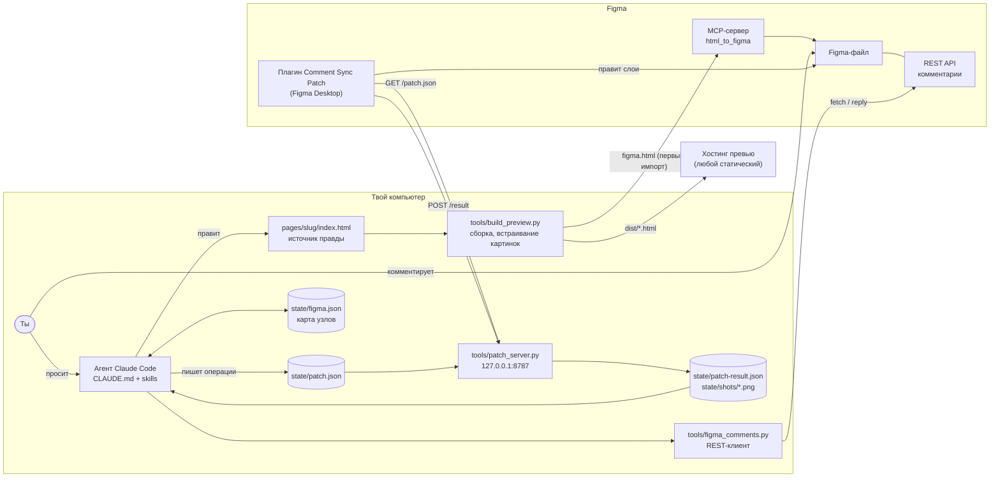
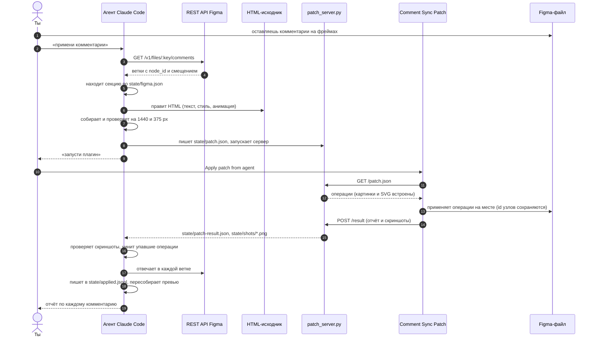
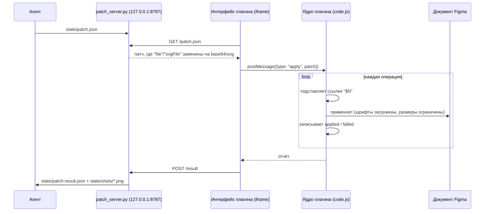

# figma-comment-sync

[English](README.md) · **Русский**

Агент на базе Claude Code, который синхронизирует HTML-страницу и Figma-файл в процессе
дизайн-ревью. Ты оставляешь комментарии в Figma. Агент их читает, меняет HTML, применяет ту же
правку в Figma-файле через небольшой плагин, отвечает в каждой ветке комментария и обновляет
HTML-превью с анимациями.

- **HTML — источник правды.** В нём настоящая вёрстка, тексты и анимации.
- **Figma — поверхность для ревью.** Дизайнеры и стейкхолдеры комментируют фреймы там.
- **Превью — то, что листают люди.** Один самодостаточный HTML-файл с работающими анимациями.

## Содержание

- [Как это работает](#как-это-работает)
- [Архитектура](#архитектура)
- [Цикл комментариев по шагам](#цикл-комментариев-по-шагам)
- [Мост к плагину](#мост-к-плагину)
- [Что нужно](#что-нужно)
- [Установка](#установка)
- [Ежедневная работа](#ежедневная-работа)
- [Структура репозитория](#структура-репозитория)
- [Решения и ограничения](#решения-и-ограничения)
- [Безопасность](#безопасность)
- [Если что-то не работает](#если-что-то-не-работает)

## Как это работает

Агент — это Claude Code плюс инструкции из этого репозитория: `CLAUDE.md` (роль, маршрутизация
команд, правила) и три skill в `.claude/skills/` (`page-build`, `figma-comments-loop`,
`localize`). Claude Code подхватывает их сам, если запустить его в папке репозитория. Всё
остальное — обычный Python и плагин Figma, без зависимостей кроме стандартной библиотеки Python.

С Figma агент общается по трём каналам, у каждого своя задача:

| Канал | Задача | Почему именно он |
|---|---|---|
| **REST API Figma** с личным токеном (`tools/figma_comments.py`) | Читать комментарии, отвечать в ветках | Ни Plugin API, ни Figma MCP не умеют читать комментарии |
| **Figma MCP** (`html_to_figma`, `create_new_file`) | Создать файл; первый раз импортировать целые секции из HTML | Единственный способ одним шагом превратить HTML в редактируемые слои |
| **Плагин Comment Sync Patch** + локальный мост (`plugin/`, `tools/patch_server.py`) | Все правки после первого импорта; чтение (`inspect`, `screenshot`) | Не тратит лимит MCP, работает детерминированно, присылает отчёт |

На бесплатном тарифе Figma MCP даёт около 20 вызовов в месяц, и правки через `use_figma` на
практике тоже списывались из этого лимита. Плагин нужен, чтобы ежедневный цикл не тратил MCP
вообще.

## Архитектура



### Компоненты

| Компонент | Файл | Роль |
|---|---|---|
| Инструкции агента | `CLAUDE.md` | Роль, маршрутизация команд, выбор канала, жёсткие правила |
| Сборка страницы | `.claude/skills/page-build/SKILL.md` | Бриф → HTML → локальная проверка → первый импорт в Figma → превью |
| Цикл комментариев | `.claude/skills/figma-comments-loop/SKILL.md` | Чтение → привязка → правка HTML → патч Figma → проверка → ответ |
| Локализация | `.claude/skills/localize/SKILL.md`, `tools/i18n.py` | Извлечение строк по ключам `data-i18n`, языковые версии, RTL |
| Сборщик | `tools/build_preview.py` | Встраивает картинки; собирает тело превью, полную страницу или вариант для Figma |
| Клиент комментариев | `tools/figma_comments.py` | `init`, `check`, `fetch`, `reply`; ведёт `state/applied.jsonl` |
| Мост | `tools/patch_server.py` | Отдаёт патч плагину, подставляет файлы, сохраняет отчёт и скриншоты |
| Плагин | `plugin/` | Применяет операции патча через Figma Plugin API |
| Карта узлов | `state/figma.json` | Секция → id фрейма, важные слои → id, ссылки на превью |

### Соглашения о странице, на которые опирается конвейер

Все они собраны в одном небольшом файле `examples/demo/index.html`.

- Один `<section data-section="NN-name">` на блок. Каждая секция становится отдельным фреймом в Figma.
- У каждой секции свой фон: фреймы Figma не наследуют цвет `<body>`.
- У видимых строк есть атрибут `data-i18n="section.key"`.
- Вкладки сделаны через `role="tabpanel"` и `hidden`, поэтому сборка для Figma может показать все варианты.
- Локальные картинки подключаются как `src="assets/..."` и встраиваются при сборке.
- Анимации уважают `prefers-reduced-motion`; сборка для Figma замораживает их в исходном положении.

## Цикл комментариев по шагам



1. **Чтение.** `figma_comments.py fetch` возвращает корневые ветки с ответами по порядку, кроме
   уже применённых из `state/applied.jsonl`. Настоящая инструкция часто стоит в ответе.
2. **Привязка.** У каждого комментария есть `client_meta.node_id` и смещение в пикселях.
   `state/figma.json` связывает узел с секцией и её HTML. Читать что-то из Figma не нужно.
3. **Правка HTML.** Изменение сначала попадает в исходник, поэтому превью и будущие импорты в
   Figma остаются согласованными.
4. **Патч Figma на месте.** Операции адресуют существующие id узлов. Узел, к которому привязан
   комментарий, не пересоздаётся, и комментарий остаётся на месте.
5. **Проверка.** В конце патча идут операции `screenshot`; агент смотрит PNG до того, как ответить.
6. **Ответ и журнал.** Один короткий ответ в ветку с точными значениями. Id ветки записывается в
   `state/applied.jsonl`, поэтому забытый комментарий не применится дважды. Комментарии удаляешь
   ты, когда результат устраивает.

## Мост к плагину



Патч — это список операций. Каждая выполняется отдельно, поэтому одна ошибочная операция
попадает в отчёт и не останавливает остальные. `"$N"` означает узел, созданный или возвращённый
операцией N того же патча: так одним патчем можно скопировать фрейм и сразу править копию.

```json
{ "id": "round-3", "page": "0:1", "ops": [
  { "op": "text", "node": "16:5", "text": "New headline" },
  { "op": "fill", "node": "10:19", "color": "#7C9CFF" },
  { "op": "setImage", "node": "40:54", "file": "pages/demo/assets/photo.png" },
  { "op": "screenshot", "node": "16:2", "scale": 0.4 }
] }
```

Операции: `text`, `fill`, `stroke`, `effects`, `set`, `resize`, `svg`, `replaceWithSvg`,
`image`, `setImage`, `badge`, `clone`, `shiftChildren`, `findSet`, `remove`, `inspect`,
`screenshot`. Полный справочник: [plugin/README.md](plugin/README.md).

Интерфейс плагина — это iframe, и только он может ходить в сеть. До моста он добирается через
`networkAccess.devAllowedDomains` в `plugin/manifest.json`; Figma разрешает это плагинам в
режиме разработки.

## Что нужно

- [Claude Code](https://claude.com/claude-code) (CLI, десктоп или IDE).
- Python 3.10 или новее. Только стандартная библиотека.
- Аккаунт Figma и **приложение Figma Desktop** (плагины в разработке не работают в браузере).
- Коннектор Figma MCP в Claude Code — для создания файлов и первого импорта.
- Личный токен Figma со scope **File comments: read и write** и **File content: read**.
- По желанию: статический хостинг для превью (подойдёт любой, который отдаёт один HTML-файл).

## Установка

```bash
git clone https://github.com/codegreenbaby/figma-comment-sync.git
cd figma-comment-sync
```

1. **Токен.** Figma > Settings > Security > Personal access tokens > Generate. Сохрани его одной
   строкой в `secrets/figma-token.txt` (файл в .gitignore).
2. **Figma-файл.** Создай его сам или попроси агента создать через MCP. Привяжи инструменты:
   ```bash
   python tools/figma_comments.py init https://www.figma.com/design/<FILE_KEY>/<name>
   python tools/figma_comments.py check
   ```
   `check` должен вывести `OK: token reads comments`.
3. **Плагин.** В Figma Desktop: Plugins > Development > Import plugin from manifest... >
   `plugin/manifest.json`.
4. **Самопроверка плагина (по желанию).** `python plugin/test/build_stub_test.py`, затем открой
   `plugin/test/stub-test.html` в браузере и найди `"PASS": true`.
5. **Запусти Claude Code в папке репозитория.** Он подхватит `CLAUDE.md` и skills.

## Ежедневная работа

С агентом можно говорить обычными словами:

| Ты говоришь | Что происходит |
|---|---|
| «Сделай страницу про X» | HTML в `pages/<slug>/`, проверенный на ширине десктопа и телефона |
| «Залей в Figma» | Вариант для Figma собирается и импортируется через MCP, по фрейму на секцию, id сохраняются |
| «Примени комментарии» | Полный цикл выше; ты один раз за раунд нажимаешь *Apply patch from agent* |
| «Собери превью» | Самодостаточный HTML в `dist/<slug>/`, готовый к публикации |
| «Переведи на de, es, ar» | Языковые версии в `dist/<slug>/<lang>/` |

Полезные команды для ручной работы:

```bash
python tools/build_preview.py examples/demo/index.html dist/demo/full.html --full              # страница для локального просмотра
python tools/build_preview.py examples/demo/index.html dist/demo/figma.html --full --show-all  # вариант для html_to_figma
python tools/build_preview.py examples/demo/index.html dist/demo/index.html                    # только тело, для хостингов с обёрткой
python tools/figma_comments.py fetch
python tools/figma_comments.py reply <comment_id> "Готово: кнопка теперь #7C9CFF"
python tools/patch_server.py
python tools/i18n.py extract examples/demo/index.html
```

## Структура репозитория

```
CLAUDE.md                     роль агента, маршрутизация, каналы, жёсткие правила
.claude/skills/
  page-build/                 бриф → HTML → импорт в Figma → превью
  figma-comments-loop/        комментарии → HTML + патч Figma → ответы
  localize/                   языковые версии
tools/
  figma_comments.py           REST-клиент комментариев (init, check, fetch, reply)
  patch_server.py             локальный мост для плагина
  build_preview.py            сборщик (тело превью, полная страница, вариант для Figma)
  i18n.py                     извлечение строк и сборка языковых версий
plugin/
  manifest.json, code.js, ui.html
  README.md                   формат патча и справочник операций
  test/                       строгая заглушка Plugin API и тест
examples/demo/index.html      минимальная страница по соглашениям
state/figma.example.json      шаблон карты узлов (настоящее состояние в .gitignore)
secrets/                      здесь лежит токен (в .gitignore)
```

## Решения и ограничения

- **Сначала HTML, а не Figma.** Перевод Figma в код требует MCP-чтения и теряет анимации.
  Генерация Figma из HTML оставляет один источник и стоит один импорт на секцию.
- **Правки на месте.** Повторный импорт секции создал бы новые id узлов и оторвал бы комментарии.
  Поэтому плагин правит существующие узлы.
- **Карта узлов вместо чтения.** `state/figma.json` обновляется после каждого импорта и патча,
  поэтому агенту редко нужно спрашивать у Figma, где что лежит.
- **Что `html_to_figma` делает с HTML:** рендерит примерно в 1280 px шириной; выбрасывает CSS
  `mask-image`; превращает `filter: drop-shadow` у картинок в прямоугольную тень; импортирует
  `` как фрейм с заливкой-картинкой; игнорирует фон `<body>`. Skills обходят каждую из этих
  особенностей.
- **Маски в Figma** работают, когда RECTANGLE с градиентной заливкой и `isMask` лежит внутри
  обычного FRAME под RECTANGLE с картинкой. Внутри группы или над импортированным фреймом
  картинки они ничего не дают.
- **Один клик за раунд.** Плагин в режиме разработки нельзя запустить извне Figma, поэтому ты
  запускаешь его один раз на каждый патч.
- **Новые секции не через плагин.** Совсем новые секции по-прежнему приходят через `html_to_figma`.

## Безопасность

- Токен читается из `secrets/figma-token.txt` или `~/.figma-token`, никогда не выводится, не
  передаётся в командной строке и не попадает в URL. `secrets/` и `state/` в .gitignore.
- Мост слушает только `127.0.0.1` и не отдаёт файлы по путям за пределами репозитория.
- Операции `set` и `findSet` принимают только свойства из белого списка.
- В `state/` лежат ключ файла и тексты комментариев; через git они с компьютера не уходят.

## Если что-то не работает

| Симптом | Причина и решение |
|---|---|
| `No token in ...` | Положи токен одной строкой в `secrets/figma-token.txt` и сохрани файл |
| `HTTP 403` на комментариях | У токена нет scope *File comments*, или аккаунт не может открыть файл |
| Плагин: «Could not reach the agent's server» | Запусти `python tools/patch_server.py`; проверь, что порт 8787 свободен |
| В заголовке плагина старый номер сборки | Figma закешировала плагин: удали его в *Manage plugins in development* и заново импортируй манифест |
| Скриншот сразу после вставки картинки пустой | Картинка ещё не загрузилась; сборки b6+ ждут её, в старых нужен отдельный патч только со скриншотом |
| MCP сообщает, что лимит вызовов исчерпан | Бюджет MCP на тарифе закончился; работай через плагин, импорты ждут следующего окна |
| Секции приходят в Figma с белым фоном | Секция полагается на цвет `<body>`; задай ей собственный фон |

## Лицензия

[MIT](LICENSE)
